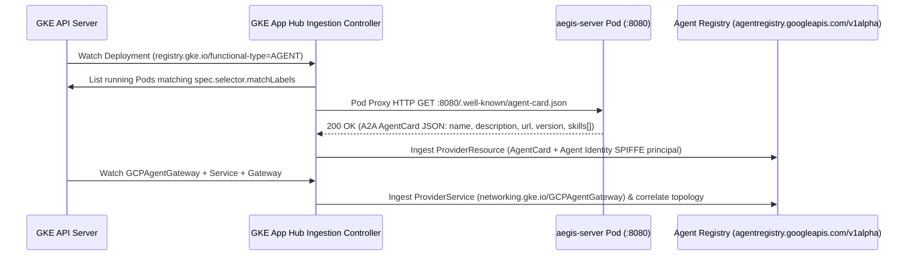
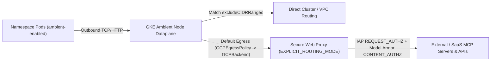

# GKE 1.37 DIY Agent Gateway CRDs (`GCPAgentGateway`, `GCPAuthzPolicy`, `GCPAuthzExtension`), Agent Registry Auto-Registration & Ambient Egress Contract

> **Research Ticket**: [#44](https://github.com/gke-demos/agent-security/issues/44) (Parent Wayfinder Map: [#43](https://github.com/gke-demos/agent-security/issues/43))
> **Primary Sources Inspected**:
> - GKE `networking.gke.io/v1` CustomResourceDefinitions and Gateway Controller OpenAPI / CEL validation rules (`GCPAgentGateway`, `GCPAuthzPolicy`, `GCPAuthzExtension`, `GCPExtensionBinding`, `GCPBackend`, `GCPEgressPolicy`)
> - Kubernetes Gateway API `gateway.networking.k8s.io/v1` (`Gateway`, `GatewayClass`, `HTTPRoute`) and GKE built-in `GatewayClass` specifications (`gke-l7-regional-external-managed`, `gke-l7-rilb`, `gke-ambient-cluster-proxy`)
> - Google Cloud Network Services & Network Security APIs (`networkservices.googleapis.com` `AgentGateway` and `AuthzExtension`, `networksecurity.googleapis.com` `AuthzPolicy`) and `gcloud network-services` / `gcloud service-extensions` / `gcloud network-security` CLIs
> - Gemini Enterprise Agent Platform documentation for Agent Gateway (`CLIENT_TO_AGENT` and `AGENT_TO_ANYWHERE`), Identity-Aware Proxy (`iap.googleapis.com`) Unified Access Policies (`iam.googleapis.com/v3`), Model Armor (`modelarmor.<region>.rep.googleapis.com`), Agent Identity on GKE (`1.37.0-gke.3503000+`), Agent Registry (`agentregistry.googleapis.com/v1alpha` and `apphub.googleapis.com`), and GKE Ambient Egress with Secure Web Proxy

---

## 1. Executive Summary & Architectural Implications for AegisSRE

1. **Current Repo Manifests (`manifests/agw-egress-config.yaml` and `manifests/02-aegis-deployment.yaml`) Require Realignment to Real GKE `1.37` Contracts**:
   - `manifests/agw-egress-config.yaml` currently models a `gcloud` control-plane `googleManaged` `AGENT_TO_ANYWHERE` YAML (`governedAccessPath: AGENT_TO_ANYWHERE`), which applies to Google-managed runtimes rather than in-cluster Kubernetes Gateway API controllers.
   - `manifests/02-aegis-deployment.yaml` exposes `aegis-server` via a bare `ClusterIP` `Service` on port `8080` with `Pod`-level `Agent Identity` annotations (`iam.gke.io/spiffe-identity-type: "agent-identity"`), but lacks:
     1. A regional Kubernetes `Gateway` + `GCPAgentGateway` + `GCPAuthzPolicy` + `GCPAuthzExtension` stack governing inbound `Operator` and A2A/MCP client traffic (`CLIENT_TO_AGENT`).
     2. `Deployment`-level `Agent Registry` discovery metadata (`registry.gke.io/functional-type: "AGENT"` and `a2a-protocol.org/agent-card`) and an A2A Agent Card HTTP endpoint (`/.well-known/agent-card.json`).
     3. `GOOGLE_API_ENABLE_RUNTIME_BOUND_TOKEN: "false"` on `aegis-server`, which is required when a Go SDK workload uses `Agent Identity` credentials against standard non-mTLS Google Cloud API endpoints.

2. **Verified GKE `CLIENT_TO_AGENT` Ingress Architecture (Primary Demo Path)**:
   - Attach a `networking.gke.io/v1` `GCPAgentGateway` (`spec.targetRefs` pointing to `gateway.networking.k8s.io/Gateway`) to a **single-cluster regional managed L7 `Gateway`** (`gatewayClassName: gke-l7-regional-external-managed` or `gke-l7-rilb`). Global (`gke-l7-global-external-managed`, `gke-l7-gxlb`) and multi-cluster (`*-mc`) classes are **rejected** by controller validation.
   - Reconciling `GCPAgentGateway` automatically provisions a regional `networkservices.googleapis.com` `AgentGateway` resource in `selfManaged` mode (`selfManaged.resourceUris` populated with the Gateway's Compute Engine regional forwarding rule URIs).
   - Once `GCPAgentGateway` is attached to a `Gateway`, `GCPAuthzPolicy` resources targeting that `Gateway` bind directly to the `AgentGateway` URI (with `loadBalancingScheme: LOAD_BALANCING_SCHEME_UNSPECIFIED`) rather than raw forwarding rules. This unlocks native Model Context Protocol (MCP) JSON-RPC inspection (`spec.rules[].to.operations[].mcp`), `CLIENT_CERT_URI_SAN` SPIFFE mTLS matching, and `CONTENT_AUTHZ` `ExtProcGRPC` streaming callouts to regional Model Armor (`modelarmor.${LOCATION}.rep.googleapis.com`).
   - **Critical Ingress Policy Limit**: A `CLIENT_TO_AGENT` ingress `Agent Gateway` supports **at most 1 `CONTENT_AUTHZ` policy** (for example, Model Armor `CONTENT_AUTHZ` prompt/response sanitization alongside deterministic `REQUEST_AUTHZ` MCP/SPIFFE allow or deny policies, up to 4 total policies).

3. **Verified Agent Registry Auto-Registration Contract on GKE**:
   - Requires `agentregistry.googleapis.com` and `apphub.googleapis.com` enabled in the cluster project on GKE `1.37.0-gke.3503000+` with Workload Identity Federation for GKE enabled.
   - Adding label `registry.gke.io/functional-type: "AGENT"` and annotation `a2a-protocol.org/agent-card` to the `apps/v1` `Deployment` (`aegis-server`), paired with Pod template annotation `iam.gke.io/spiffe-identity-type: "agent-identity"`, causes the GKE App Hub ingestion controller to probe running pods over the Kubernetes pod proxy (`GET :8080/.well-known/agent-card.json`) and synchronize the agent's A2A skills, metadata, and `Agent Identity` principal into `agentregistry.googleapis.com/v1alpha`.
   - **Critical Discovery Gotcha**: If the `a2a-protocol.org/agent-card` annotation is **omitted**, the controller does **not** probe `:8080/.well-known/agent-card.json` by default; instead, it falls back to registering only `{ "displayName": "<deployment-name>" }` with zero A2A skills or card metadata.
   - Ingesting `networking.gke.io/GCPAgentGateway` into App Hub (`ResourceType: networking.gke.io/GCPAgentGateway`) links the regional `Gateway` frontend topology to the workload, while `aegis-server`'s `/.well-known/agent-card.json` handler should also advertise the external `Gateway` URL (via `PUBLIC_AGENT_URL`) so direct A2A clients resolve the governed `CLIENT_TO_AGENT` endpoint.

4. **Why `manifests/ambient-egress/` Should Remain an Optional Reference Overlay**:
   - In-cluster `AGENT_TO_ANYWHERE` egress on GKE uses `networking.gke.io/v1` `GCPBackend` (strictly `spec.serviceUris` with 1 Secure Web Proxy or Private Service Connect attachment URI and all other `GCPBackend` fields omitted) and a namespace-singleton `GCPEgressPolicy` (`spec.to.excludeCIDRRanges` + `spec.proxyRef`).
   - **Verified Preview Compatibility Constraint**: GKE Ambient Egress in `1.37` Preview requires `--enable-ambient-networking` and currently supports standard Workload Identity Federation for GKE (`${PROJECT_ID}.svc.id.goog`) on the Ambient dataplane rather than managed `Agent Identity` trust domains (`agents.global.org-${ORG_ID}.system.id.goog`), and requires manual pod mounting of the Secure Web Proxy TLS inspection CA (`swp-ca-cert.pem`). Shipping Ambient Egress as a documented reference overlay under `manifests/ambient-egress/` preserves `Agent Identity` on the primary `aegis-server` deployment while giving platform teams verified schemas for Ambient + Secure Web Proxy egress.

---

## 2. Part 1: GKE `CLIENT_TO_AGENT` Ingress Governance (`networking.gke.io/v1`)

```mermaid
flowchart LR
    Client["Operator / A2A or MCP Client"] -->|"HTTPS / mTLS"| FwdRule["Regional Forwarding Rule (GKE Gateway)"]
    FwdRule <-->|"selfManaged.resourceUris"| AGW["networkservices AgentGateway (from GCPAgentGateway)"]
    AGW -->|"1. REQUEST_AUTHZ (Headers / MCP / SPIFFE / IAP)"| ReqAuthz["GCPAuthzPolicy (ALLOW / DENY / CUSTOM)"]
    ReqAuthz -->|"2. CONTENT_AUTHZ (FULL_DUPLEX_STREAMED)"| MAExt["GCPAuthzExtension (modelarmor.REGION.rep.googleapis.com)"]
    MAExt --> Route["HTTPRoute -> Service :8080"]
    Route --> Pod["aegis-server Pod (Agent Identity + ADK SecurityPlugin)"]
```



### 2.1 `GCPAgentGateway` CRD Schema & `GatewayClass` Compatibility

- **API Group / Version / Kind**: `networking.gke.io/v1`, `Kind: GCPAgentGateway` (Namespaced, CRD category `gateway-api`, plural `gcpagentgateways`).
- **Cluster Prerequisite**: Standard Gateway API controller enabled on the GKE `1.37+` cluster (`--gateway-api=standard` on Standard; enabled by default on Autopilot).

#### Field Reference & CEL Validation Rules

| Field | Type | Required | Validation / Semantics |
|---|---|---|---|
| `spec` | `GCPAgentGatewaySpec` | Conditional | **Required** when attaching to a regional GKE `Gateway` (`gke-l7-regional-external-managed` or `gke-l7-rilb`). May be omitted (`spec: {}`) **only** when defining a standalone `GCPAgentGateway` for `gke-ambient-cluster-proxy` referenced via `networking.gke.io/agent-gateway`. |
| `spec.targetRefs` | `[]LocalPolicyTargetReference` | Yes (when `spec` set) | `MinItems: 1`, `MaxItems: 10`. Each item contains `group`, `kind`, and `name` (same namespace only; cross-namespace references are not supported). CEL enforces `self.targetRefs.all(ref, ref.group == 'gateway.networking.k8s.io' && ref.kind == 'Gateway')`. |
| `status.ancestors[]` | `[]PolicyAncestorStatus` | Output only | Standard Gateway API `PolicyStatus` written by `controllerName: networking.gke.io/gateway` with `ancestorRef` pointing to the attached `Gateway` and `conditions[]` (`Attached` / `Accepted`). |

#### Supported vs. Rejected `GatewayClass` Matrix

The GKE Gateway controller enforces `!IsMultiCluster(class) && (IsRegionalExternalManaged(class) || IsRegionalInternal(class))` for `GCPAgentGateway`:

| `gatewayClassName` | Load Balancer Type | `GCPAgentGateway` Support | Controller Behavior |
|---|---|---|---|
| `gke-l7-regional-external-managed` | Regional External Application Load Balancer | **Supported** | Reconciles regional `AgentGateway` with `selfManaged.resourceUris` |
| `gke-l7-rilb` | Regional Internal Application Load Balancer | **Supported** | Reconciles regional `AgentGateway` with `selfManaged.resourceUris` |
| `gke-ambient-cluster-proxy` | In-cluster Ambient L7 Proxy | **Supported (Standalone)** | `Gateway` references standalone `GCPAgentGateway` via `networking.gke.io/agent-gateway` annotation |
| `gke-l7-global-external-managed` | Global External Application Load Balancer | **Rejected** | `Attached: False` (`Reason: Invalid`, `"GatewayClass is not supported"`) |
| `gke-l7-gxlb` | Classic Global External Application Load Balancer | **Rejected** | `Attached: False` (`Reason: Invalid`, `"GatewayClass is not supported"`) |
| `gke-l7-regional-external-managed-mc` / `gke-l7-rilb-mc` | Multi-Cluster Regional Application Load Balancer | **Rejected** | `Attached: False` (`Reason: Invalid`, `"GatewayClass is not supported"`) |

#### Reconciliation into `networkservices.googleapis.com` `AgentGateway`

1. **Precedence & Conflict Handling**: At most **one** `GCPAgentGateway` can attach to a given `Gateway`. If multiple `GCPAgentGateway` resources target the same `Gateway`, only the highest-precedence policy (oldest `creationTimestamp`, then alphabetical `metadata.name`) is translated; subsequent policies receive a `Conflicted` condition (`conflicted with GCPAgentGateway "<ns>/<name>", which is already applied to the same target`).
2. **Cloud Resource Translation**: For each matched regional `Gateway`, the controller synthesizes a regional `networkservices.googleapis.com` `AgentGateway` resource in the cluster's region with:
   ```json
   {
     "name": "projects/${PROJECT_NUMBER}/locations/${LOCATION}/agentGateways/<generated-id>",
     "description": "AgentGateway created by GKE Gateway Controller",
     "selfManaged": {
       "resourceUris": [
         "https://www.googleapis.com/compute/v1/projects/${PROJECT_ID}/regions/${LOCATION}/forwardingRules/<fr-name>"
       ]
     }
   }
   ```
3. **Target Rebinding for `GCPAuthzPolicy` and `GCPAuthzExtension`**: When a `GCPAgentGateway` is attached to a `Gateway`:
   - Every `GCPAuthzPolicy` targeting that `Gateway` sets `AuthzPolicy.target.resources = ["projects/${PROJECT_NUMBER}/locations/${LOCATION}/agentGateways/<generated-id>"]` instead of targeting raw Compute Engine forwarding rules, and sets `loadBalancingScheme = LOAD_BALANCING_SCHEME_UNSPECIFIED`.
   - Every referenced `GCPAuthzExtension` sets `AuthzExtension.loadBalancingScheme = LOAD_BALANCING_SCHEME_UNSPECIFIED`.

---

### 2.2 `GCPAuthzPolicy` CRD Schema, CEL Rules & Native MCP Matching

- **API Group / Version / Kind**: `networking.gke.io/v1`, `Kind: GCPAuthzPolicy` (Namespaced, plural `gcpauthzpolicies`).

#### Top-Level `spec` Fields & CEL Constraints

| Field | Type | Required | Allowed Values & CEL Validation Rules |
|---|---|---|---|
| `enforcementLevel` | `string` | **Yes** | `L7` or `L4`. **CEL**: Must be `L7` when `action == 'CUSTOM'` or when targeting `Service`. Always use `L7` for `Gateway` ingress governance. |
| `action` | `AuthzAction` | No (default `ALLOW`) | `ALLOW`, `DENY`, `CUSTOM`, `DENY_BY_DEFAULT`. On `Gateway` targets, only `ALLOW`, `DENY`, and `CUSTOM` are valid (`DENY_BY_DEFAULT` is restricted by CEL to `kind: Pod` with empty selector). |
| `policyProfile` | `PolicyProfile` | No (default `REQUEST_AUTHZ`) | `REQUEST_AUTHZ` or `CONTENT_AUTHZ`. **Immutable** (`self == oldSelf`; changing requires recreate). **CEL**: `self.policyProfile == 'CONTENT_AUTHZ' ? self.action == 'CUSTOM' : true`. |
| `targetRefs` | `[]LocalObjectReference` | **Yes** | `MinItems: 1`, `MaxItems: 10`. For `Gateway` ingress: `group: gateway.networking.k8s.io`, `kind: Gateway`, `name: <gateway-name>` (`selector` forbidden). |
| `customProviders` | `*CustomProviders` | Conditional | **CEL**: Required when `action == 'CUSTOM'` and forbidden otherwise (`self.action == 'CUSTOM' ? has(self.customProviders) : !has(self.customProviders)`). |
| `customProviders.extensionRefs` | `[]v1.LocalObjectReference` | Yes (for `CUSTOM`) | `MinItems: 1`, `MaxItems: 2`. Each item specifies `group: networking.gke.io`, `kind: GCPAuthzExtension`, `name: <extension-name>` in the **same namespace**. |
| `rules` | `[]GCPAuthPolicyRule` | Conditional | `MaxItems: 10`. **CEL**: Required non-empty (`size(self.rules) > 0`) when `action` is `ALLOW` or `DENY`. Optional when `action == 'CUSTOM'` (omitting `rules` invokes the custom extension on all requests). |

#### `REQUEST_AUTHZ` vs. `CONTENT_AUTHZ` Evaluation Semantics

1. **Sequential Profile Ordering**: When both profiles are attached to an `Agent Gateway`, `REQUEST_AUTHZ` policies execute **first** on HTTP request headers before payload streaming. Only requests permitted by `REQUEST_AUTHZ` proceed to `CONTENT_AUTHZ` extensions.
2. **`CONTENT_AUTHZ` Wire Protocol**: Streams all 6 Envoy `ext_proc` lifecycle events (`REQUEST_HEADERS`, `REQUEST_BODY`, `REQUEST_TRAILERS`, `RESPONSE_HEADERS`, `RESPONSE_BODY`, `RESPONSE_TRAILERS`) in `FULL_DUPLEX_STREAMED` body mode, allowing Model Armor or custom gRPC callouts to block or mutate prompts and responses in flight.
3. **Policy Concurrency Quotas**:
   - **Per-Gateway**: `CLIENT_TO_AGENT` ingress gateways support **at most 1 `CONTENT_AUTHZ` policy** (Model Armor and Semantic Governance Policies cannot be combined on the same ingress gateway). Overall `Agent Gateway` policy attachment is capped at **4 authorization policies**; execution order among multiple `CUSTOM` policies sharing the same `policyProfile` is not guaranteed.
   - **Per-Project Default Quota**: 10 `GCPAuthzPolicy` and 10 `GCPAuthzExtension` resources per Google Cloud project.

#### Source Identity Matching (`spec.rules[].from.sources[]` / `notSources[]`)

Up to 5 `Source` entries per `from` block (ORed across entries; fields within a single `Source` are ANDed):

- **`principals[]` (`MaxItems: 10`)**: Matches authenticated client X.509 certificate identities on mTLS-enabled `Gateway` listeners:
  - `principalSelector`: `CLIENT_CERT_URI_SAN` (default — matches the full X.509 URI SAN, such as a caller's `Agent Identity` SPIFFE ID), `CLIENT_CERT_DNS_NAME_SAN`, or `CLIENT_CERT_COMMON_NAME`.
  - `principal`: `StringMatchCriteria` (`type`, `value`, `ignoreCase`). **CEL strictly requires `type: Exact`** (`self.type == 'Exact'`) for `principal` matching; prefix/suffix/contains matchers are rejected at admission! When `principalSelector: CLIENT_CERT_URI_SAN` is used, `value` must be the complete `spiffe://...` URI SAN string.
- **`cidrBlocks[]` (`MaxItems: 10`)**: Valid IPv4 or IPv6 CIDR ranges (for example, `10.128.0.0/20`).
- **`resources[]` (`MaxItems: 10`)**: Matches Compute Engine `tagValueIdSet` (`tagValueIds[]`, `MaxItems: 10`, ANDed) and/or `iamServiceAccount` (`type: Exact`, `value: "<sa-email>"`) on internal load balancers (`gke-l7-rilb`).

#### Operation & Native MCP Matching (`spec.rules[].to.operations[]` / `notOperations[]`)

Up to 5 `Operation` entries per `to` block (ORed across entries; fields within a single `Operation` are ANDed):

- **HTTP Matchers**:
  - `hosts[]` (`MaxItems: 10`), `paths[]` (`MaxItems: 10`): `StringMatchCriteria` where `type` is PascalCase: `Exact` | `Prefix` | `Suffix` | `Contains`, `value` (`1..1024` chars), and optional `ignoreCase: bool`.
  - `methods[]` (`MaxItems: 10`): Uppercase HTTP verbs (`GET`, `HEAD`, `POST`, `PUT`, `DELETE`, `CONNECT`, `OPTIONS`, `TRACE`, `PATCH`).
  - `headers[]` (`MaxItems: 10`): `name` (`1..64` chars), `type` (`Exact` | `Prefix` | `Suffix` | `Contains`), `value`, `ignoreCase`.
- **Native MCP JSON-RPC Matcher (`mcp: *MCPMatch`)**:
  - **Requirements**: **CEL** enforces `targetRefs.all(r, r.kind == 'Gateway')`, and the Gateway controller requires a `GCPAgentGateway` attached to that `Gateway` (otherwise `GCPAuthzPolicy` reports `Accepted: False` with `"mcp is only supported when agent gateway is attached to the gateway"`).
  - **`baseProtocolMethodsOption`**:
    - `SKIP_BASE_PROTOCOL_METHODS` (**default**): Base MCP session lifecycle RPCs (`initialize`, `ping`, `logging/*`, `completion/*`, `notifications/*`) are **not** matched by the rule. Keep this default on `action: DENY` policies so blocking a tool does not break session establishment.
    - `MATCH_BASE_PROTOCOL_METHODS`: Base MCP session lifecycle RPCs **are** matched alongside `methods[]`. **Critical Gotcha**: On `action: ALLOW` policies, you **must** set `baseProtocolMethodsOption: MATCH_BASE_PROTOCOL_METHODS` (plus `tools/list` if clients discover tools dynamically), otherwise MCP clients fail handshake initialization with `HTTP 403`!
  - **`methods[]` (`MaxItems: 10`)**:
    - Category wildcards (`params` **forbidden** by CEL): `tools`, `prompts`, `resources`.
    - List methods (`params` **forbidden** by CEL): `tools/list`, `prompts/list`, `resources/list`, `resources/templates/list`.
    - Parameterized methods (`params` **allowed** by CEL): `tools/call`, `prompts/get`, `resources/read`, `resources/subscribe`, `resources/unsubscribe`.
    - `params[]` (`MaxItems: 10`): `[]StringMatchCriteria` (`type: Exact | Prefix | Suffix | Contains`, `value: "<tool_or_resource_name>"`, `ignoreCase: bool`). On `tools/call`, matches `params.name` in the JSON-RPC 2.0 request body (`{"jsonrpc":"2.0","method":"tools/call","params":{"name":"..."}}`).

#### CEL `when` Condition (`spec.rules[].when`)

- Optional string (`1..512` chars) evaluated alongside `from` and `to`.
- Supports Service Extensions CEL attributes including `request.headers["<lowercase-header>"]`, `request.method`, `request.host`, `request.path`, `request.query`, `request.scheme`, `source.address`, `source.port`, `connection.requested_server_name`, `connection.tls_version`, `connection.sha256_peer_certificate_digest`, and string functions (`startsWith`, `endsWith`, `contains`, `matches`, `lowerAscii`, `upperAscii`).
- **Best Practice with Model Armor**: Scope `CONTENT_AUTHZ` rules with `when: 'request.headers["content-type"].startsWith("application/json") || request.headers["content-type"].startsWith("text/")'` (or target specific HTTP paths / MCP operations) so binary/GET health probes and static UI asset fetches bypass Model Armor inspection latency.

---

### 2.3 `GCPAuthzExtension` CRD Schema for Model Armor & IAP

- **API Group / Version / Kind**: `networking.gke.io/v1`, `Kind: GCPAuthzExtension` (Namespaced, plural `gcpauthzextensions`).
- **Same-Namespace Rule**: `Gateway`, `GCPAgentGateway`, `GCPAuthzPolicy`, and `GCPAuthzExtension` must all reside in the **same Kubernetes namespace**.

#### Field Reference & CEL Validation Rules

| Field | Type | Required | Validation / Semantics |
|---|---|---|---|
| `googleAPIServiceName` | `string` | Mutually exclusive with `backendRef` | Managed Google API endpoint (`MaxLength: 100`, pattern `^[a-z0-9.-]+\.googleapis\.com$`). **CEL**: Exactly one of `googleAPIServiceName` or `backendRef` must be set, and **`authority` must NOT be set** when `googleAPIServiceName` is used (`has(self.googleAPIServiceName) ? !has(self.authority) : true`). |
| `backendRef` | `*ExtensionServiceReference` | Mutually exclusive with `googleAPIServiceName` | In-cluster custom gRPC `ext_proc` `Service` (`group: ""`, `kind: Service`, `name`, `port`). **CEL**: Requires non-empty `authority` and explicit `timeout`. |
| `wireFormat` | `*WireFormat` | Recommended | `ExtProcGRPC` (supported on regional Gateways only; required for `ExtProc` managed callouts such as Model Armor). |
| `timeout` | `*Duration` | Conditional | `10ms` to `10000ms` (`10s`). Required by CEL when `backendRef` is set; defaults to `5s` in the GKE translator when `googleAPIServiceName` is set (`1s`–`5s` recommended for Model Armor and IAP). |
| `failOpen` | `*bool` | No (default `false`) | When `false` (recommended zero-trust default), extension errors or timeouts reject the request (`HTTP 500`) and policy denials return `HTTP 403`. |
| `forwardHeaders` | `[]HTTPHeaderName` | No | `MaxItems: 50`. Headers forwarded to the extension; if omitted, all request headers are forwarded. |
| `forwardAttributes` | `[]string` | No | `MaxItems: 16`. Envoy CEL attributes forwarded in `ProcessingRequest.attributes` (for example, `source.ip`). |
| `metadata` | `map[string]string` | Service-specific | `MaxProperties: 100`, keys `1..63` chars, values `1..1023` chars, total serialized protobuf `Struct` size `<= 1024` bytes. Passed to the extension under `metadata_context` namespace `com.google.authz_extension.<resource_name>`. |

#### Managed Service Contract 1: Model Armor (`CONTENT_AUTHZ`)

- **`googleAPIServiceName`**: Must use the **regional** REP endpoint matching the Gateway's region:
  ```text
  modelarmor.${LOCATION}.rep.googleapis.com
  ```
  Global `modelarmor.googleapis.com` is **rejected** by controller validation on regional `Gateway` classes (`invalid Google API service name: "modelarmor.googleapis.com", does not contain load balancer region`).
- **Required `GCPAuthzPolicy` Pairing**: Must be referenced **only** by a `GCPAuthzPolicy` with `action: CUSTOM`, `enforcementLevel: L7`, and `policyProfile: CONTENT_AUTHZ`.
- **`metadata.model_armor_settings`**: Stringified JSON array specifying `request_template_id` and/or `response_template_id`:
  ```yaml
  metadata:
    model_armor_settings: '[{"request_template_id":"projects/${PROJECT_ID}/locations/${LOCATION}/templates/aegis-ingress-prompt","response_template_id":"projects/${PROJECT_ID}/locations/${LOCATION}/templates/aegis-ingress-response"}]'
  ```
  Keep whitespace compact so the serialized `metadata` struct stays well under the `1024`-byte limit.
- **Required Service Agent IAM Grants (Mandatory Even Within the Same Project)**:
  The Service Extensions data-plane service agent `service-${PROJECT_NUMBER}@gcp-sa-dep.iam.gserviceaccount.com` must be granted:
  1. `roles/modelarmor.calloutUser` and `roles/serviceusage.serviceUsageConsumer` on the project hosting the `Gateway` / `GCPAgentGateway`.
  2. `roles/modelarmor.user` on the project hosting the Model Armor templates.
  3. If the Model Armor template uses Cloud Sensitive Data Protection (`sdpSettings.advancedConfig` inspect/de-identify templates), grant `roles/dlp.user` and `roles/dlp.reader` to `service-${PROJECT_NUMBER}@gcp-sa-modelarmor.iam.gserviceaccount.com`.

#### Managed Service Contract 2: Identity-Aware Proxy (`REQUEST_AUTHZ`)

- **`googleAPIServiceName`**: `iap.googleapis.com` (global service identifier accepted on regional Gateways).
- **Required `GCPAuthzPolicy` Pairing**: Must be referenced **only** by a `GCPAuthzPolicy` with `action: CUSTOM`, `enforcementLevel: L7`, and `policyProfile: REQUEST_AUTHZ`.
- **Mandatory `metadata` Keys on `AgentGateway`**:
  - `iapPolicyVersion`: `"V2"` (strongly recommended — evaluates IAM v3 `Unified Access Policy` `AccessPolicy` bindings) or `"V1"` (evaluates legacy IAM `Allow` bindings such as `roles/iap.httpsResourceAccessor` / `roles/iap.egressor`). Omitting `iapPolicyVersion` when targeting an `AgentGateway` fails backend validation.
  - `iamEnforcementMode`: Optional `"DRY_RUN"` for audit-only rollout (logs policy verdicts to Cloud Logging without blocking requests); omit to enforce.
- **Organization Policy Prerequisite for `V2` Unified Access Policies**: Disable `constraints/iam.managed.disableAccessPolicyBindings` on the target project/folder so `AccessPolicy` bindings can be attached. Note that in Gemini Enterprise Agent Platform, Unified Access Policies with `iap.googleapis.com/resources.egressViaIAP` and `Agent Registry` destination attributes primarily govern `AGENT_TO_ANYWHERE` egress, whereas `CLIENT_TO_AGENT` GKE ingress combines `Gateway` TLS/IAP authentication, `GCPAuthzPolicy` MCP/SPIFFE `ALLOW`/`DENY` rules, and Model Armor `CONTENT_AUTHZ` guardrails.

> [!NOTE]
> GKE `1.37` also introduces `GCPExtensionBinding` (`networking.gke.io/v1`), which binds a `producerExtension` directly to `targetRef: { group: networking.gke.io, kind: GCPAgentGateway, name: <name> }` for SaaS/producer-managed governance engines (such as Semantic Governance Policy engines). For customer-managed Model Armor and IAP guardrails on DIY GKE `Gateway` ingress, `GCPAuthzPolicy` + `GCPAuthzExtension` is the standard declarative contract.

---

### 2.4 Complete Schema-Validated `CLIENT_TO_AGENT` Ingress Manifests for AegisSRE

All resources below reside in namespace `aegis-sre` and conform to the `networking.gke.io/v1` and `gateway.networking.k8s.io/v1` OpenAPI/CEL schemas:

```yaml
apiVersion: gateway.networking.k8s.io/v1
kind: Gateway
metadata:
  name: aegis-ingress-gw
  namespace: aegis-sre
spec:
  gatewayClassName: gke-l7-regional-external-managed
  listeners:
    - name: https
      protocol: HTTPS
      port: 443
      tls:
        mode: Terminate
        certificateRefs:
          - kind: Secret
            name: aegis-ingress-tls
      allowedRoutes:
        namespaces:
          from: Same
---
apiVersion: networking.gke.io/v1
kind: GCPAgentGateway
metadata:
  name: aegis-client-to-agent
  namespace: aegis-sre
spec:
  targetRefs:
    - group: gateway.networking.k8s.io
      kind: Gateway
      name: aegis-ingress-gw
---
apiVersion: gateway.networking.k8s.io/v1
kind: HTTPRoute
metadata:
  name: aegis-server-route
  namespace: aegis-sre
spec:
  parentRefs:
    - group: gateway.networking.k8s.io
      kind: Gateway
      name: aegis-ingress-gw
  rules:
    - matches:
        - path:
            type: PathPrefix
            value: /
      backendRefs:
        - group: ""
          kind: Service
          name: aegis-server
          port: 8080
---
# 1. Deterministic Edge Block: Reject destructive MCP tool calls at the L7 Gateway edge
apiVersion: networking.gke.io/v1
kind: GCPAuthzPolicy
metadata:
  name: aegis-mcp-deny-destructive
  namespace: aegis-sre
spec:
  enforcementLevel: L7
  action: DENY
  policyProfile: REQUEST_AUTHZ
  targetRefs:
    - group: gateway.networking.k8s.io
      kind: Gateway
      name: aegis-ingress-gw
  rules:
    - to:
        operations:
          - mcp:
              baseProtocolMethodsOption: SKIP_BASE_PROTOCOL_METHODS
              methods:
                - name: tools/call
                  params:
                    - type: Exact
                      value: delete_namespace
                    - type: Prefix
                      value: admin_drop_
---
# 2. Edge AI Safety Guardrail: Regional Model Armor CONTENT_AUTHZ ExtProc callout
apiVersion: networking.gke.io/v1
kind: GCPAuthzExtension
metadata:
  name: aegis-model-armor-ext
  namespace: aegis-sre
spec:
  googleAPIServiceName: modelarmor.${LOCATION}.rep.googleapis.com
  wireFormat: ExtProcGRPC
  timeout: 2s
  failOpen: false
  forwardHeaders:
    - Content-Type
    - Authorization
  forwardAttributes:
    - source.ip
  metadata:
    model_armor_settings: '[{"request_template_id":"projects/${PROJECT_ID}/locations/${LOCATION}/templates/aegis-prompt-shield","response_template_id":"projects/${PROJECT_ID}/locations/${LOCATION}/templates/aegis-sdp-shield"}]'
---
apiVersion: networking.gke.io/v1
kind: GCPAuthzPolicy
metadata:
  name: aegis-model-armor-content-authz
  namespace: aegis-sre
spec:
  enforcementLevel: L7
  action: CUSTOM
  policyProfile: CONTENT_AUTHZ
  targetRefs:
    - group: gateway.networking.k8s.io
      kind: Gateway
      name: aegis-ingress-gw
  customProviders:
    extensionRefs:
      - group: networking.gke.io
        kind: GCPAuthzExtension
        name: aegis-model-armor-ext
  rules:
    - to:
        operations:
          - methods: ["POST"]
            paths:
              - type: Prefix
                value: /api/chat
              - type: Prefix
                value: /a2a
              - type: Prefix
                value: /mcp
      when: 'request.headers["content-type"].startsWith("application/json")'
```

*(Optional mTLS Peer-Agent `ALLOW` Rule Snippet — when exposing a dedicated mTLS listener for A2A peer agents with `Agent Identity` client certificates)*:

```yaml
  rules:
    - from:
        sources:
          - principals:
              - principalSelector: CLIENT_CERT_URI_SAN
                principal:
                  type: Exact
                  value: "spiffe://agents.global.org-${ORG_ID}.system.id.goog/resources/container/projects/${PROJECT_NUMBER}/locations/${CLUSTER_LOCATION}/clusters/${CLUSTER_NAME}/ns/aegis-sre/sa/peer-agent-sa"
      to:
        operations:
          - mcp:
              baseProtocolMethodsOption: MATCH_BASE_PROTOCOL_METHODS
              methods:
                - name: tools/list
                - name: tools/call
                  params:
                    - type: Exact
                      value: query_incident_status
```

---

## 3. Part 2: Agent Registry Auto-Registration & Agent Identity on GKE

### 3.1 Cluster & Project Prerequisites

1. **GKE Version & Identity Pool**: GKE cluster running `1.37.0-gke.3503000` or later with Workload Identity Federation for GKE enabled (`--workload-pool=${PROJECT_ID}.svc.id.goog` on Standard; automatic on Autopilot).
2. **Enabled Google Cloud APIs**:
   ```bash
   gcloud services enable \
     agentregistry.googleapis.com \
     apphub.googleapis.com \
     container.googleapis.com \
     iam.googleapis.com \
     --project="${PROJECT_ID}"
   ```
   Enabling `apphub.googleapis.com` activates the managed GKE App Hub workload ingestion controller for clusters in the project.
3. **Supported Workload Scope**:
   - Automatic GKE discovery ingests **`apps/v1` `Deployment`** resources in non-system Kubernetes namespaces within the **same GCP project** (`StatefulSet`, `DaemonSet`, and bare `Pod` workloads are not auto-registered as agents).
   - Cross-project agents require manual registration via `agentregistry.googleapis.com/v1alpha` `Service` resources (`gcloud beta agent-registry services create`).

---

### 3.2 Exact `Deployment` & `Pod` Metadata Contract

| Surface | Key | Kind | Required | Exact Value & Ingestion Behavior |
|---|---|---|---|---|
| `Deployment.metadata.labels` | `registry.gke.io/functional-type` | Label | **Yes** | `"AGENT"` or `"MCP_SERVER"` (**uppercase, case-sensitive**). Marks the `Deployment` for `Agent Registry` ingestion and instructs GKE node logging agents to stamp container logs with the canonical `urn:agent:...` identifier. *(Deprecated annotation `apphub.cloud.google.com/functional-type: "AGENT"` is accepted only as a legacy fallback.)* |
| `Deployment.metadata.annotations` | `a2a-protocol.org/agent-card` | Annotation | **Yes (for A2A card & skills)** | Embedded YAML string configuring `card.endpoint` (default `"/.well-known/agent-card.json"`), `card.protocol` (default `"HTTP"`), and `card.port` (default `"8080"`). **If omitted completely, pod probing is skipped** and only `{ "displayName": "<deployment-name>" }` is registered without skills or card metadata! |
| `Deployment.spec.template.metadata.annotations` | `iam.gke.io/spiffe-identity-type` | Pod Annotation | **Yes** | `"agent-identity"`. Provisions a workload-bound `Agent Identity` and populates the `agentPrincipal` identity record in `Agent Registry`. |
| `Deployment.spec.template.metadata.annotations` | `iam.gke.io/identity` | Pod Annotation | **Yes** | `"spiffe://agents.global.org-${ORG_ID}.system.id.goog/*"` (organization project) or `"spiffe://agents.global.proj-${PROJECT_NUMBER}.system.id.goog/*"` (org-less project). |
| `Deployment.spec.template.metadata.annotations` | `iam.gke.io/inject-podcertificates` | Pod Annotation | Recommended | `"true"`. Mounts `gke-workload-spiffe-credentials` at `/var/run/secrets/workload-spiffe-credentials/` containing the 24-hour X.509 SVID bundle (`x509.credential-bundle.private-key.pem`, rotated by kubelet) and SPIFFE trust bundle (`<trust-domain>.spiffe-trust-bundle.pem`). |

#### Issued `Agent Identity` Identifiers

For `ServiceAccount` `aegis-agent-sa` in namespace `aegis-sre`:

- **SPIFFE ID (X.509 URI SAN)**:
  ```text
  spiffe://agents.global.org-${ORG_ID}.system.id.goog/resources/container/projects/${PROJECT_NUMBER}/locations/${CLUSTER_LOCATION}/clusters/${CLUSTER_NAME}/ns/aegis-sre/sa/aegis-agent-sa
  ```
- **IAM Principal (for IAM / Unified Access Policy / Principal Access Boundary bindings)**:
  ```text
  principal://agents.global.org-${ORG_ID}.system.id.goog/resources/container/projects/${PROJECT_NUMBER}/locations/${CLUSTER_LOCATION}/clusters/${CLUSTER_NAME}/ns/aegis-sre/sa/aegis-agent-sa
  ```
- **Go SDK Runtime Token Binding Gotcha (`GOOGLE_API_ENABLE_RUNTIME_BOUND_TOKEN`)**:
  `Agent Identity` on GKE `1.37` defaults to issuing X.509 certificate-bound access tokens (`cnf.x5t#S256` thumbprint) that require `*.mtls.googleapis.com` transport bindings (currently auto-negotiated only in Python `google-auth >= 2.61.0`). Because `aegis-server` is a Go binary calling standard Google Cloud APIs (`aiplatform.googleapis.com`, `modelarmor.${LOCATION}.rep.googleapis.com`, `dlp.googleapis.com`, `agentregistry.googleapis.com`), set `GOOGLE_API_ENABLE_RUNTIME_BOUND_TOKEN="false"` in the container `env` so the GKE metadata server issues standard bearer tokens for ADC while preserving the pod's `Agent Identity` principal in Cloud Audit Logs and IAM policy evaluation.

---

### 3.3 Agent Card Introspection Flow & `GCPAgentGateway` URL Synchronization



1. **In-Cluster Pod Probing Mechanics**:
   - When `a2a-protocol.org/agent-card` is present on a `Deployment`, the GKE ingestion controller lists `Running` pods matching `Deployment.spec.selector.matchLabels` and issues an in-cluster Kubernetes API pod-proxy HTTP request to `<protocol>:<pod-name>:<port><endpoint>` (defaulting any omitted subfields under `card:` to `protocol: HTTP`, `port: "8080"`, `endpoint: "/.well-known/agent-card.json"`).
   - The returned JSON must conform to the A2A Agent Card specification (`name`, `description`, `url`, `version`, `capabilities`, `defaultInputModes`, `defaultOutputModes`, `skills[]`).
2. **How `GCPAgentGateway` Links to `Agent Registry`**:
   - The GKE ingestion controller also watches `networking.gke.io/v1` `GCPAgentGateway` custom resources and ingests each resource into App Hub as a `ProviderService` of `ResourceType: "networking.gke.io/GCPAgentGateway"` with canonical URI:
     ```text
     //container.googleapis.com/projects/${PROJECT_NUMBER}/locations/${CLUSTER_LOCATION}/clusters/${CLUSTER_NAME}/k8s/namespaces/${NAMESPACE}/networking.gke.io/gcpagentgateways/${NAME}
     ```
   - App Hub's topology graph correlates `GCPAgentGateway` -> `Gateway` (regional forwarding rule VIP/hostname) -> `HTTPRoute` -> Kubernetes `Service` -> `Deployment`, associating the governed gateway frontend with the registered `Agent` entry in `agentregistry.googleapis.com/v1alpha` (`projects/${PROJECT_ID}/locations/${LOCATION}/agents/<agent-id>`).
   - **Implementation Requirement for `aegis-server`**: Serve `GET /.well-known/agent-card.json` on port `8080` and populate the card's `url` field from an environment variable `PUBLIC_AGENT_URL` (defaulting to the regional `Gateway` HTTPS URL once provisioned, or `http://aegis-server.aegis-sre.svc.cluster.local:8080` in cluster-local mode) so both `Agent Registry` discovery and direct A2A callers use the governed `CLIENT_TO_AGENT` ingress URL.

---

### 3.4 Production-Ready `Deployment` Manifest (`manifests/02-aegis-deployment.yaml` Target Contract)

```yaml
apiVersion: apps/v1
kind: Deployment
metadata:
  name: aegis-server
  namespace: aegis-sre
  labels:
    app: aegis-server
    registry.gke.io/functional-type: "AGENT"
  annotations:
    a2a-protocol.org/agent-card: |
      card:
        endpoint: /.well-known/agent-card.json
        protocol: HTTP
        port: "8080"
spec:
  replicas: 1
  selector:
    matchLabels:
      app: aegis-server
  template:
    metadata:
      labels:
        app: aegis-server
      annotations:
        iam.gke.io/spiffe-identity-type: "agent-identity"
        iam.gke.io/identity: "spiffe://agents.global.org-${ORG_ID}.system.id.goog/*"
        iam.gke.io/inject-podcertificates: "true"
    spec:
      serviceAccountName: aegis-agent-sa
      containers:
        - name: server
          image: ${REGION}-docker.pkg.dev/${PROJECT_ID}/aegis-sre/aegis-server:latest
          ports:
            - name: http
              containerPort: 8080
              protocol: TCP
          env:
            - name: PORT
              value: "8080"
            - name: GOOGLE_CLOUD_PROJECT
              value: "${PROJECT_ID}"
            - name: GOOGLE_CLOUD_LOCATION
              value: "${LOCATION}"
            - name: PUBLIC_AGENT_URL
              value: "https://${GATEWAY_DOMAIN}"
            - name: GOOGLE_API_ENABLE_RUNTIME_BOUND_TOKEN
              value: "false"
```

#### Verification Commands (`gcloud` & REST `v1alpha`)

```bash
# List auto-registered agents in the regional Agent Registry
gcloud agent-registry agents list \
  --project="${PROJECT_ID}" \
  --location="${LOCATION}" \
  --filter="displayName='aegis-server'"

# Inspect the full v1alpha Agent resource (including A2A skills, protocols, and URN)
curl -fsS -H "Authorization: Bearer $(gcloud auth print-access-token)" \
  "https://agentregistry.googleapis.com/v1alpha/projects/${PROJECT_ID}/locations/${LOCATION}/agents"
```

---

## 4. Part 3: Reference Ambient Egress Overlay (`manifests/ambient-egress/`)

### 4.1 Architecture & Prerequisites

For GKE clusters running the Ambient Networking dataplane (`--enable-ambient-networking` and `--gateway-api=standard`), outbound Pod traffic (`AGENT_TO_ANYWHERE`) can be transparently redirected at the namespace level through a regional **Secure Web Proxy (SWP)** configured in `EXPLICIT_ROUTING_MODE` (backed by `networkservices.googleapis.com` `AgentGateway` / `AuthzPolicy` / `AuthzExtension` policies for IAP Unified Access Policies and Model Armor egress inspection).



---

### 4.2 `GCPBackend` & `GCPEgressPolicy` CRD Schemas (`networking.gke.io/v1`)

#### 1. `GCPBackend` (`networking.gke.io/v1`, Namespaced, plural `gcpbackends`)

Although the general `GCPBackend` OpenAPI CRD defines multiple backend union fields (`hostname`, `port`, `type`, `cloudrun`, `backendservice`, `serviceUris`), **the GKE `GCPEgressPolicy` translator enforces strict validation**:

- **`spec.serviceUris`** (exact camelCase field name `serviceUris`): **Required**, and **must contain exactly 1 URI** (`len(serviceUris) == 1`).
- **`hostname`, `port`, `type`, `cloudrun`, and `backendservice` MUST ALL BE OMITTED**. Setting any of those fields on a `GCPBackend` referenced by `GCPEgressPolicy` causes reconciliation to fail with `Accepted: False` (`Reason: Invalid`, `only serviceURIs are allowed`).
- **Supported `serviceUris[0]` Formats**:
  1. **Same-VPC Secure Web Proxy**:
     `//networkservices.googleapis.com/projects/${PROJECT_ID}/locations/${LOCATION}/gateways/${SWP_GATEWAY_NAME}`
  2. **Cross-VPC Private Service Connect (PSC) Service Attachment**:
     `//compute.googleapis.com/projects/${PROJECT_ID}/regions/${LOCATION}/serviceAttachments/${PSC_ATTACHMENT_NAME}`

#### 2. `GCPEgressPolicy` (`networking.gke.io/v1`, Namespaced, plural `gcpegresspolicies`)

| Field | Type | Required | Validation / Semantics |
|---|---|---|---|
| `spec.to.excludeCIDRRanges` | `[]CIDR` | No | Exact field casing `excludeCIDRRanges` (uppercase `CIDR`). Valid IPv4/IPv6 CIDRs bypassing the egress proxy (must include GKE control-plane CIDR, Pod CIDR, Service CIDR, and internal VPC ranges that should not hairpin through SWP). |
| `spec.proxyRef` | `LocalPolicyTargetReference` | **Yes** | Must specify `group: networking.gke.io`, `kind: GCPBackend`, and `name: <gcpbackend-name>` in the **same namespace**. Any other `group` or `kind` is rejected. |
| `status.conditions[]` | `[]metav1.Condition` | Output only | Reports `type: Accepted` (`status: True | False`, `reason: Accepted | Invalid`). |

- **Singleton Per Namespace Rule**: At most **one `GCPEgressPolicy` is active per Kubernetes namespace**. If multiple `GCPEgressPolicy` objects exist in the same namespace, only the oldest resource (by `creationTimestamp`, tie-broken alphabetically by `metadata.name`) is translated into a Network Services `EgressRouting` resource; all newer policies receive conflict errors.

#### 3. Standalone `GCPAgentGateway` + `gke-ambient-cluster-proxy` Binding

For East-West / in-cluster Ambient L7 waypoint proxies using `gatewayClassName: gke-ambient-cluster-proxy`:
- Create a standalone `GCPAgentGateway` with `spec` omitted (`apiVersion: networking.gke.io/v1`, `kind: GCPAgentGateway`, `metadata.name: <agw-name>`).
- Bind the `gke-ambient-cluster-proxy` `Gateway` to that `GCPAgentGateway` via `Gateway.metadata.annotations["networking.gke.io/agent-gateway"]: "<agw-name>"`.

---

### 4.3 Verified GKE `1.37` Preview Limitations for Ambient Egress

1. **Workload Identity Pool Constraint**: In GKE `1.37` Preview, Ambient Egress (`GCPEgressPolicy` + Secure Web Proxy mTLS workload authentication) supports standard Workload Identity Federation for GKE (`${PROJECT_ID}.svc.id.goog`), **not** managed `Agent Identity` (`agents.global.org-${ORG_ID}.system.id.goog`) on the Ambient node dataplane. Keeping Ambient Egress in an opt-in `manifests/ambient-egress/` overlay avoids breaking `Agent Identity` on the primary `aegis-server` deployment.
2. **Namespace-Wide Scope Only**: `GCPEgressPolicy` applies to every Pod in the namespace (no `podSelector` filtering).
3. **Manual TLS Inspection CA Trust**: When Secure Web Proxy TLS inspection is enabled (`CONTENT_AUTHZ` / MCP payload inspection over HTTPS), the proxy CA certificate (`swp-ca-cert.pem`) is not auto-injected and must be mounted into Pods via a `ConfigMap` / `SSL_CERT_FILE` environment variable.
4. **Recreate on Proxy Target Change**: Updating the underlying SWP gateway or PSC attachment requires deleting and recreating the `GCPEgressPolicy` resource.

---

### 4.4 Reference Manifests for `manifests/ambient-egress/`

```yaml
# manifests/ambient-egress/01-gcpbackend-swp.yaml
apiVersion: networking.gke.io/v1
kind: GCPBackend
metadata:
  name: aegis-swp-egress-backend
  namespace: aegis-sre
spec:
  serviceUris:
    - "//networkservices.googleapis.com/projects/${PROJECT_ID}/locations/${LOCATION}/gateways/aegis-swp-egress"
---
# manifests/ambient-egress/02-gcpegresspolicy.yaml
apiVersion: networking.gke.io/v1
kind: GCPEgressPolicy
metadata:
  name: aegis-namespace-egress
  namespace: aegis-sre
spec:
  to:
    excludeCIDRRanges:
      - "10.0.0.0/8"
      - "172.16.0.0/12"
      - "192.168.0.0/16"
  proxyRef:
    group: networking.gke.io
    kind: GCPBackend
    name: aegis-swp-egress-backend
---
# manifests/ambient-egress/03-ambient-cluster-proxy-gateway.yaml (Optional L7 Waypoint)
apiVersion: networking.gke.io/v1
kind: GCPAgentGateway
metadata:
  name: aegis-ambient-agent-gateway
  namespace: aegis-sre
---
apiVersion: gateway.networking.k8s.io/v1
kind: Gateway
metadata:
  name: aegis-ambient-waypoint
  namespace: aegis-sre
  annotations:
    networking.gke.io/agent-gateway: "aegis-ambient-agent-gateway"
spec:
  gatewayClassName: gke-ambient-cluster-proxy
  listeners:
    - name: http
      protocol: HTTP
      port: 80
```

---

## 5. Summary of Actionable Decisions for Downstream Wayfinder Tickets

| Area | Verified Contract | Action Required in Implementation Tickets |
|---|---|---|
| **Ingress Gateway (`manifests/03-ingress-agent-gateway.yaml`)** | `Gateway` (`gke-l7-regional-external-managed` or `gke-l7-rilb`) + `GCPAgentGateway` (`spec.targetRefs`) + `HTTPRoute` -> `Service/aegis-server:8080`. | Replace schematic `manifests/agw-egress-config.yaml` with real GKE `1.37` `CLIENT_TO_AGENT` ingress manifests (`GCPAgentGateway`, `GCPAuthzPolicy`, `GCPAuthzExtension`). |
| **Edge MCP & Model Armor Policies** | `GCPAuthzPolicy` requires `enforcementLevel: L7`, `customProviders.extensionRefs` (`group: networking.gke.io`, `kind: GCPAuthzExtension`), PascalCase `StringMatchCriteria.type` (`Exact`/`Prefix`), and regional `modelarmor.${LOCATION}.rep.googleapis.com` with `metadata.model_armor_settings` JSON array (`<= 1024` bytes). | Ship 1 `REQUEST_AUTHZ` `DENY` MCP policy + 1 `CONTENT_AUTHZ` `CUSTOM` Model Armor policy, plus setup script IAM bindings for `service-${PROJECT_NUMBER}@gcp-sa-dep.iam.gserviceaccount.com`. |
| **Agent Registry & A2A Card (`manifests/02-aegis-deployment.yaml` + Go server)** | `Deployment` requires `labels["registry.gke.io/functional-type"]: "AGENT"` AND `annotations["a2a-protocol.org/agent-card"]`; Pod requires `iam.gke.io/spiffe-identity-type: "agent-identity"` + `GOOGLE_API_ENABLE_RUNTIME_BOUND_TOKEN="false"`. | Add label, annotation, and env var to `manifests/02-aegis-deployment.yaml`, and implement `GET /.well-known/agent-card.json` on `aegis-server:8080` advertising `PUBLIC_AGENT_URL`. |
| **Ambient Egress Overlay (`manifests/ambient-egress/`)** | `GCPBackend` (`spec.serviceUris` only, 1 URI) + singleton `GCPEgressPolicy` (`excludeCIDRRanges`, `proxyRef`). Incompatible with `Agent Identity` on the same pod in `1.37` Preview. | Ship under `manifests/ambient-egress/` with README documenting `--enable-ambient-networking`, SWP `EXPLICIT_ROUTING_MODE`, and Workload Identity preview scope. |
